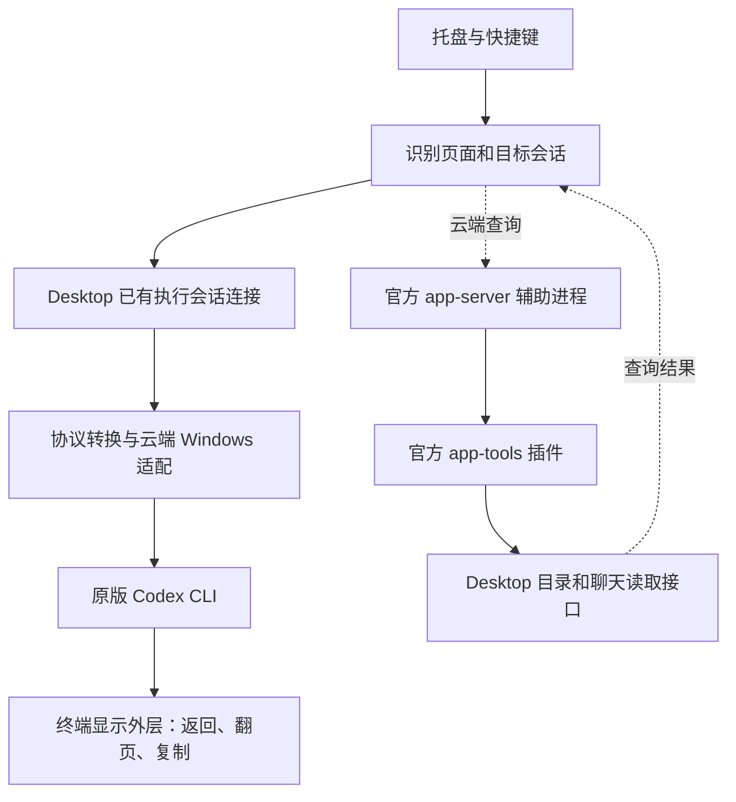

# 云端终端首次打开优化方案

状态：已执行有证据支持的改动，2026-10-26。对照基线：`63735c8`。下文保留设计和门槛；具体落地范围、未实现方向与实测见 [验收记录](CLOUD-FIRST-OPEN-ACCEPTANCE.md)。

## 目标和范围

优化“打开一次、持续观看约半小时、数小时后再次打开”的使用方式。以没有 Codex Session to Terminal 近期候选缓存的首次打开为验收基线，保留原版 Windows Codex CLI、云端只读和普通 ChatGPT 启动方式。

不新增数据库、持久会话索引、后台扫描、跨窗口共享查询服务或常驻预热进程。允许一次连接期间必需的快照、消息和请求状态；这些不作为下一次打开的候选缓存。Desktop 和官方运行时自身的缓存不由本工具清除，也不能宣称其完全冷启动。

现有 5 分钟候选缓存已经退出默认路径，相关模块不再分发；不删除用户既有私有状态。已有人工关联文件作为兼容输入保留，不新增自动写入或延长关联有效期。

## 当前架构与瓶颈

- 托盘、面板和 Windows 小助手使用 PowerShell/C#；连接、协议转换和终端外层使用 Node.js。
- 定位成功后的快照和增量来自 Desktop 原有会话连接。云端查询助手负责找会话，不负责持续生成或实时输出。
- 云端内容比对目前逐条读取最近/置顶目录内的候选，共用一个官方查询助手，最多同时查询 3 条。先取 2 轮，不足时最多扩展到 4 轮；完整扫描用于排除目录范围内的重复候选。
- 内容只能提出候选，显示前还要核对原生历史边界和最新用户消息 ID。此规则不改为“找到第一条就接受”。标题路径仍是目录范围内的只读选择规则，不能升级为可靠的前端/执行 ID 关联。
- 原生连接尚未建立时，仍可能需要现有的临时打开执行视图、连接、返回流程。这段耗时与查找对应关系分开衡量。

2026-10-26 的有限样本：

| 阶段 | 观察结果 | 结论范围 |
| --- | --- | --- |
| 本机管道发现及验证 | 编译助手 62–74 ms；旧路径 1593–2133 ms | 已部署的独立测量，不等于整体启动时间 |
| 已安装版助手初始化及目录查询 | 一次 3.641 s | 包含本机与 Desktop/云端等待，不能全部归为网络 |
| 内容定位 | 约 13–15 s | 当前主要瓶颈 |
| 已安装版原生连接 | 一次 1.576 s | 当时已有 Desktop owner |
| 引擎启动到正确首屏 | 对照均值 23.064 → 19.779 s | 两组交错对照、范围重叠，不含快捷键和窗口创建 |

当前准确的用户体验指标应从快捷键被接受开始，到正确标题、可见正文和只读提示同时出现结束；窗口弹出或显示“正在连接”不算成功首屏。

## 优先方向一：直接定位执行会话

先调查当前 Desktop 公开到本机的只读数据，是否已有可外部读取的“当前前端会话 ID → 当前执行会话 ID”关系。目标是一次定向查询替代对其他聊天的扫描，不建立本工具自己的对应关系缓存。

调查范围限于已注册的只读接口、现有 IPC 协议和准确会话链接。先检查接口是否存在、返回字段是否包含关系，再做窄范围读取验证。已有 UIA 页面标题和 `app://-/index.html` 不能提供这层关系；窗口选中状态、最近更新时间、共同消息祖先也不能替代关系证明。

已有开发记录确认：当时的 `list_threads` / `read_thread` 投影没有一般性的前端/执行 ID 对，原生摘要也未提供 `clientId`。这一点要作为已知限制，不重新重复尝试相同摘要参数。只有发现新增字段或不同的现有外部读入口，才进入实现阶段。

可接受结果必须绑定确切页面/前端 ID、执行 ID 和 `durable` 主机，并具有可核验的来源。如果前端能切换执行实例、恢复或分叉，需要识别当前关系，不能只证明两条记录曾共享消息。最终仍进行当前执行状态、最新消息和页面上下文校验，校验前不显示候选正文。

建议流程：

1. 已拿到准确原生链接时，沿用现有直接连接。
2. 确有可用关系接口时，做一次限定目标的读取。
3. 关系有效则跳过候选扫描，完成原生校验和连接。
4. 无此能力、超时、结果冲突或格式变化时，回到现有标题/内容流程。

新增本机关系探测以 500 ms 为初始预算，只做一次，不在每个候选上重复尝试；若实测接口需要网络且不能满足该预算，不能伪装成本机快速路径，应重新评估是否值得放到主流程。没有已确认能力时直接跳过，不对未知方法反复试探。

**进入产品的门槛：**准确目标之外的正文查询数降为 0；改名、同名、分叉、继续执行和切换页面的测试均不误连。接口缺失的常规路径不能因为实验探测明显变慢。

## 优先方向二：减少查询过程的启动和往返

现有查询链路经过官方 app-server 与 app-tools。app-server 创建本次查询专用的真实辅助聊天，并给插件提供调用者元数据；结束时归档该辅助聊天。它并非单纯的字节转发器。现有插件缺少调用者元数据会拒绝请求，不能借用用户聊天 ID、伪造 renderer 身份或复制登录凭据来省掉这一层。

先测清助手初始化、首次工具发现、单次请求排队、Desktop 等待、响应解析和关闭分别占多少时间，再选择一个有证据的简化点：

- 若已有外部只读通道支持独立客户端正常注册，比较能否减少一层辅助执行器；身份、工具权限和取消机制必须等价。没有这个能力就保留现有官方路径。
- 若已有接口支持批量读取必要的消息标识或关系字段，比较“一次目录/批量读取”与多次 `read_thread`。不能把同样的逐条请求包进一个函数就称为减少往返；部分失败或缺少候选时不能作唯一性判断。
- 合并本次打开内部的重复读取，或并行准备确实独立的步骤。保留查询结束后的新鲜性复核，不用开头读到的数据冒充末尾复核。不要在尚未知道是否为云端聊天时为每次本地快捷键都启动云端助手。

并发从 3 提高到 6、只读最新一轮预筛、减少文字返回量，已有实验未显示稳定首开收益，不作为默认方案。候选排序可以改变查询顺序，但在没有更强关联证据时不能提前终止唯一性检查。

**进入产品的门槛：**减少可计数的请求或启动步骤，并在无候选缓存的交错对照中改善首屏；单独减少响应字节数不算成功。若收益不足以抵消兼容与维护成本，保留旧实现。

## 配套减负：首屏后释放查询助手

当前已有 owner、无需页面恢复的路径中，`reader` 在 `runView` 结束后的 `finally` 才关闭。因此一次半小时观看可能让定位用的 app-server 和插件进程也保留半小时。返回 Desktop 按钮已使用独立的导航小助手，不需要这个 reader。

在身份校验、连接和可能的页面恢复结束后，查询助手可以作为提前释放的候选。设计上先让正确首屏显示，再启动有界清理；不能把辅助聊天归档和进程关闭的等待放到首屏前面。终端最终退出时仍应等待/收尾同一项清理，避免重复释放、未处理异常或遗留进程。

实时 follower、云端适配层和 CLI 保持运行。需要重新定位时重新创建按次查询助手，不为重连保留一个永久预热进程。清理查询助手失败不能误关已经建立的观看连接。

这是降低持续观看资源占用的方向，不宣称能省去首次定位的 13–15 秒。验证必须覆盖首屏后的流式更新、翻页、复制、返回按钮、owner 变化和关闭终端；先确认查询助手与实际 owner 的生命周期无隐藏耦合。

## 实施与验收

按小步骤推进，不同时重写定位器、传输和终端渲染：

1. 补充分阶段测量，沿用现有诊断文件，只记耗时、请求数、结果类型和资源数量，不写标题、正文、会话编号或凭据。计时使用单调时钟；跨进程事件用本次运行标识关联，不能直接相减各进程的计时原点。
2. 对直接关系入口做一轮有边界的可行性调查，交付“支持的接口与校验规则”或“未找到可用入口”的证据。后者不阻塞其他方向，也不继续积累未使用的探测代码。
3. 一次实现一个已证实的优化，先测首屏，再做回归。查询助手提前释放作为独立改动衡量资源占用。
4. 验收通过后替换默认路径；旧标题/内容定位仍作自动回退。缓存分支退役放在独立清理改动中，不顺带删除既有私有配置。

测试至少覆盖：有标题、无标题、同名/分叉、短回复、正在生成、刚点击继续、已有 owner 和需要临时打开执行视图。活跃聊天不发送或中断消息；需要制造状态的测试只使用已明确授权的专用测试聊天。

性能比较使用同一组聊天、独立运行目录、禁用本工具候选缓存，新旧版本交错执行。已有 owner 与首次创建 owner 分开报告；不重启用户 ChatGPT 来制造全冷状态。先用少量试验筛掉无效方向，准备发布的路径再收集至少 10 组配对样本，记录成功/失败、首屏中位数和范围；样本不足时不报告稳定 P95。

设计目标是减少完整候选扫描，让已有 owner 的无缓存首开明显低于当前约 20 秒；当前没有证据承诺固定秒数。回退路径额外探测等待以 500 ms 为上限目标，不能用更长的静默等待换取偶尔命中。owner 初始化或云端服务变慢时单列原因。

轻量验收同时记录本工具所拥有的进程树和工作集，比较首屏、观看 30 秒及关闭后的资源；只读助手应在释放后不再存活，关闭终端后不遗留新子进程。测量数据只是诊断，不作为之后连接的索引或缓存。

回退只关闭本次新增探测或替换回此前 reader 实现；保留原版 CLI、现有只读限制、原来的定位兜底和页面返回流程。新格式不被识别时应明确失败或回退，不靠猜测继续显示其他聊天。

## 主要代码位置

| 位置 | 本方案涉及的职责 |
| --- | --- |
| `CST-Tray.ps1`、`Thread-Link.ps1`、`Desktop-Context.cs` | 快捷键上下文、准确链接和页面识别 |
| `cst-cloud-terminal.mjs` | 定位顺序、连接生命周期、阶段诊断和 reader 清理 |
| `cloud-desktop-reader.mjs`、`cloud-app-tools.mjs` | 官方查询入口、调用者身份和辅助进程 |
| `cloud-title-selection.mjs`、`cloud-identity-links.mjs` | 标题选择、内容候选和原生消息校验 |
| `desktop-ipc.mjs`、`cloud-owner-activation.mjs` | 原生连接与有界页面恢复 |
| `terminal-diagnostics.mjs` | 每个实际终端的有界、无内容诊断快照；替代已退役的候选缓存模块进入安装清单 |
| `cloud-windows-attachment.mjs`、`terminal-session-view.mjs` | 保持现有观看和原版 CLI 路径 |

现有实验与边界见 [Cloud Work 开发记录](CLOUD-DEVELOPMENT.md)，产品架构见 [README](README.md)。
