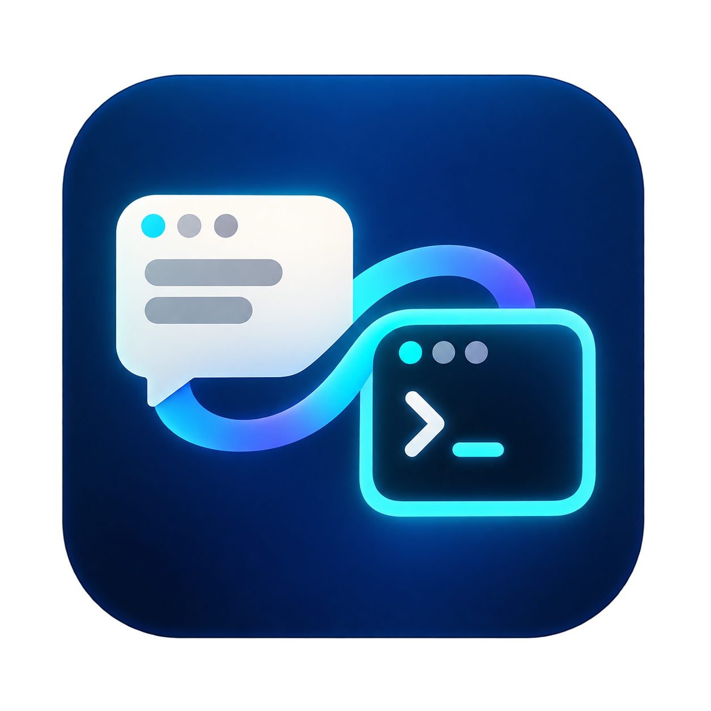
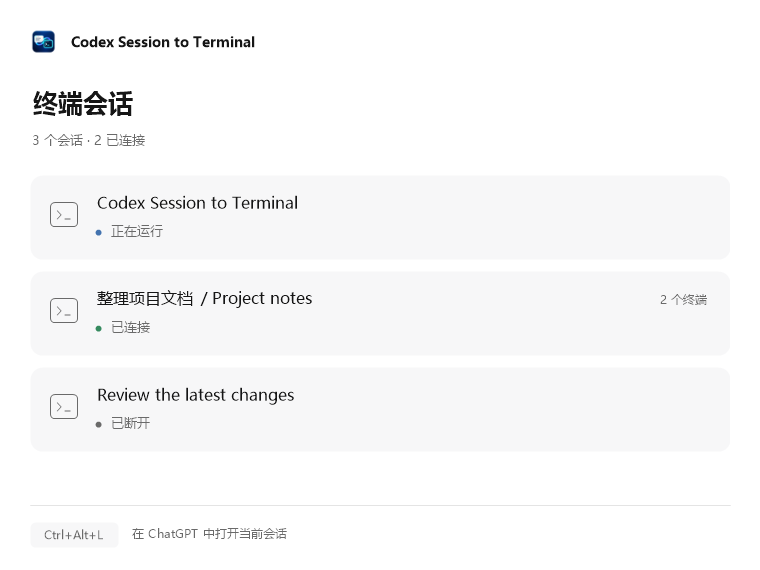

# Codex Session to Terminal



在 Windows 上，为已经运行的 ChatGPT 本地 Work / Codex 聊天打开实时终端，也可选择云端执行会话进行只读观看。Codex Session to Terminal 独立驻留系统托盘，退出后 ChatGPT 继续工作。

**0.2 Preview · Windows x64 · 非官方集成。** 新版通过 Desktop 已有的本机通信通道跟随当前会话，不修改官方程序、快捷方式或启动参数，不需要重启 ChatGPT。检查通信能力和协议格式，不锁定 Desktop 的完整版本号。

源码：[MrPhotato/codex-session-to-terminal](https://github.com/MrPhotato/codex-session-to-terminal)。公开安装包：[GitHub Releases](https://github.com/MrPhotato/codex-session-to-terminal/releases)。发布页仍标为 0.1 的安装包使用旧方案；请以版本和发布说明为准。

## 使用方法

1. 像平常一样打开 ChatGPT。
2. 双击 `Start-CST.cmd`，或桌面、开始菜单的 **Codex Session to Terminal**。应用打开会话面板、驻留系统托盘，并发出一次启动通知；再次打开会显示已有实例的面板。
3. 在 ChatGPT 聊天中按 **Ctrl+Alt+L**。本地聊天直接用官方 Codex CLI 打开；云端聊天优先使用准确链接，其次尝试匹配当前页面完整标题，无法明确匹配时显示列表。输入前点击终端。
4. 单击托盘图标查看终端会话面板。关闭面板会收回托盘。
5. 右键托盘图标选择 **退出 / Exit**，断开本轮所有终端；ChatGPT 和已接受的任务继续运行。

本地和云端终端的右上角均有固定的 **在 ChatGPT 中打开 ↗ / Open in ChatGPT ↗** 按钮。按钮留在窗口顶部，翻历史时不滚动。点击后使用 Desktop 自带的会话链接，按这条终端绑定的会话 ID 请求跳转，并请求将已有窗口前置。当前未发现已运行的 Desktop 时不执行；派发前如果你切到了其他应用，也会取消。这个操作不发送消息，不修改 ChatGPT 安装或启动配置。

云端按钮目前定位到这条原生云端执行会话的桌面视图。执行会话与原 ChatGPT Work 聊天使用不同 ID，未取得可靠对应关系时不会根据标题猜测原 Work 页面。

会话面板仅显示本轮打开的终端会话，展示实际连接状态和是否有任务运行。同一聊天打开多个终端时合并显示数量。关闭终端后自动移除，失去心跳的连接不会继续显示为已连接。面板和托盘菜单的深浅色跟随 Windows 应用主题，中英文跟随 Windows 显示语言（其他语言使用英文），没有额外切换按钮。托盘菜单显示完整产品名称、ChatGPT 是否已打开及快捷键提示，提供查看会话、打开云端只读会话和退出三个操作。启动通知遵循 Windows 的通知和勿扰设置。

<picture>
  <source media="(prefers-color-scheme: dark)" srcset="assets/session-panel-dark.png">
  
</picture>

Codex Session to Terminal 使用 ChatGPT 自带的“复制聊天链接”快捷键，并在官方 Desktop 位于前台时观察同一组合键。如果约一秒内没有收到受支持的会话链接，就尝试读取该窗口的页面标题，用于云端只读候选匹配。读取有 4 秒超时，不阻塞托盘；无法读取时显示列表。切换到其他窗口会取消启动等待。它不抢占系统快捷键、不发送模拟按键，也不保存按键内容或剪贴板。

| 本地会话终端操作 | 行为 |
| --- | --- |
| Enter | 空闲时发送新一轮；任务运行时补充当前任务 |
| Ctrl+Enter 或 Tab | 加入会话队列，等待当前任务完成后处理 |
| Esc | 中断当前任务，同步回 Desktop |
| CLI 的历史浏览与输入快捷键 | 沿用官方 CLI 操作 |
| Ctrl+C 或 `/quit` | 退出这个 CLI；任务运行时先留意 CLI 的中断提示 |

部分 Windows 终端会把 Ctrl+Enter 编码成普通 Enter，这时请用 **Tab** 排队。Tab 已实测；Ctrl+Enter 已在本次 CLI 进程配置，实际按键取决于终端。Codex Session to Terminal 不修改你的全局终端快捷键。排队由这个 CLI 管理，关闭该终端会丢弃尚未发送的队列；Desktop 已接受的任务继续运行。发送确认超时后，会按唯一消息编号核对原会话的服务端回执；仍无法确认时请检查桌面，不自动重发消息。

本地终端使用未修改的官方 Codex CLI。支持历史显示、运行中接入、双向文本消息、补充、排队、工具输出和中断。支持索引分页的聊天先显示最近消息，向上翻阅时再加载旧记录，无需等 Desktop 加载整段历史；较老的 legacy 格式仍使用完整历史兼容路径。可按 Ctrl+C 取消连接等待。历史缺口或读取失败会明确报错，不把未读完的历史显示成已经结束。审批、附件、模型切换、插件交互和未接入的原生命令仍在 Desktop 处理。远程主机及 SSH 任务不在本版范围内。

终端连接和权限设置通知使用 Desktop 已保存的下一轮设置，避免与上一轮权限缓存不一致。发送时仍由 Desktop 继承这些设置；连接层不会把终端的权限覆盖参数传给 Desktop。

历史内容每页最多读取 20 个记录项（消息、工具调用或输出等）。官方 CLI 按窗口大小决定首屏需要几页，向上翻阅时继续读取；这不会修改官方 CLI 配置。最近历史的内容也只在返回对应页面时复制，避免打开时提前复制整轮的大段工具输出。页数和单条记录大小不同，首屏总量及耗时不会固定。

## 云端会话：只读观看

在云端 ChatGPT 页面按 **Ctrl+Alt+L**：能取得准确链接时直接打开；否则读取按快捷键时那个窗口的主页面标题，并在最近及置顶目录中寻找完整标题严格相同的候选。只有前端聊天和云端执行会话各恰好一个同名项、没有本地同名项，且连接前回读的标题和页面仍一致，才自动打开。重名、改名、通用标题、读取失败或缺少候选时显示列表。托盘菜单的 **打开云端只读会话 / Open online read-only session** 始终显示列表供手动选择。

通过当前页面识别出的云端聊天，如果尚未建立原生连接，会临时打开该聊天的执行记录页面，连接后自动返回跳转前的页面。已有连接则直接打开终端。自动返回使用客户端自身的“返回”，不根据标题猜测原页面；等待期间有键盘、鼠标活动或页面变化时，保留当前页面，不自动返回。手动选择列表或没有可靠窗口上下文时，不自动跳转。终端仍只读，不发送消息或修改设置。

标题匹配是只读观看的便利功能，不是唯一会话身份凭据。目录最多包含最近 50 条及全部置顶，无法保证目录以外没有同名聊天。标题助手只读取窗口主页面标题；执行会话没有名称时，再通过官方只读接口核对近期用户消息，具体范围见下文。这些匹配均不用于发送或控制。

云端窗口仍运行未经修改的官方 Windows Codex CLI，外层隐藏输入区域并始终显示 **Online Session Read Only for Terminal**。除右上角返回 Desktop 的按钮外，只允许 **Page Up / Page Down、Ctrl+Home / Ctrl+End 和鼠标滚轮** 浏览历史。输入、粘贴、Enter、Tab、Esc、Ctrl+C、Ctrl+D、命令及设置快捷键都不会传给 CLI；连接层另行拒绝发送、补充、排队、中断和修改请求。关闭这个终端窗口即可退出观看，不会中断云端任务。

两种模式都由终端外层保留顶部一行，下面运行原版 CLI。本地模式保留编辑区，键盘及粘贴内容转交 CLI；鼠标坐标按顶部一行的偏移调整。云端继续使用只读输入过滤。导航使用预先编译的小助手，通过已核对的官方程序转交会话链接，省去 PowerShell 的启动和运行时编译；不启动模型执行器、不读取聊天历史，也不保留常驻导航进程。界面的「已请求打开」表示链接已交付，不代表页面已经加载完成。

安装包包含导航助手和只读标题助手。源码运行可分别执行 `powershell -NoProfile -File .\Build-Navigation.ps1` 和 `powershell -NoProfile -File .\Build-Context.ps1`。未生成导航助手时使用较慢的 PowerShell 兼容路径；未生成标题助手时保留云端选择列表。

窗口缩放后原地重绘；太小时只显示只读提示，放大后恢复内容。连接依赖 Desktop 的原生执行视图；当前页面已确认而连接尚未建立时，使用上面的临时打开和返回流程，不发送消息。暂不支持的附件、媒体和历史格式会明确报错。未列出不表示账号中没有该聊天。手动和自动选择最终均绑定原生云端执行 ID；返回 Desktop 按钮继续打开该执行视图，不把标题匹配当作前端页面 ID 的关联证明。

部分云端聊天的底层标题为空。程序会读取前端聊天及目录内执行会话的最近 4 轮，每项最多 4096 字符，比较最近两条完整用户消息，寻找唯一候选。最多检查 64 条执行会话，共用一个辅助进程，最多同时发起 3 个只读查询；发现过程限时 18 秒，启动和读取目录的耗时另计。少于两条用户消息、消息过短或被截断、重复候选、查询失败或超时均不建立关联。列表优先显示前端聊天名称，避免只看到无法辨认的编号。

消息正文只用于筛选候选。显示历史前，还会核对原生快照中最新用户消息 ID 与前端消息 ID，并检查历史边界完整性；同一轮内追加的普通用户消息也纳入核对。无法确认的补充消息格式会停止连接。程序不持久保存自动发现的关联或消息正文。此时终端标签使用前端聊天标题，仅影响显示，不重命名官方会话。目录之外的分叉或同源聊天仍无法穷尽检查，不能把这一匹配当作全账号唯一关系的证明。

以前人工核对过的候选关联仍可从 Codex Session to Terminal 自己的 `cloud-identity-links.json` 读取，每次也须通过最新消息 ID 校验；文件不包含正文或凭证，不随安装包分发。新聊天不要求手工添加此文件。

## 从旧版升级

当前版本统一使用独立连接方案，标准入口为 **Codex Session to Terminal**。不再提供单独的 Independent 或 Legacy Shared Startup 入口，也无需先退出 ChatGPT。安装器仅迁移能够识别为本产品的旧快捷方式，保留指向其他目标的自定义快捷方式。

## 安装与运行要求

- Windows x64，正常安装并登录 `OpenAI.Codex` 桌面包。
- 需要 Node.js 22+ 和 PowerShell 7.4+；安装包附带运行时。源码部署先运行 `npm ci`，再运行 `Start-CST.cmd`。
- 推荐 Windows Terminal，没有时使用 PowerShell 控制台。
- `Start-CST.ps1 -Check` 仅检查文件、运行时、依赖和执行策略，不下载依赖、不打开托盘或 ChatGPT。
- 不设置系统执行策略，不绕过管理员/用户明确配置的 Restricted 或 AllSigned。

安装器不启动或关闭任何应用；当前用户安装，无需管理员权限。卸载保留私有状态及 ChatGPT 账号和聊天历史。首次启动 Codex Session to Terminal 时下载锁定的官方 CLI 和适配层依赖。

## 连接与本地数据

Codex Session to Terminal 在现有 `codex-ipc` 管道注册自己的客户端身份，发现会话原 owner，再订阅快照与增量。连接前在同一管道句柄上验证服务进程属于当前 Windows 用户及已安装的官方 Desktop 路径。它不声明会话所有权、不独立 resume 正在运行的聊天。

官方 CLI 连接 Codex Session to Terminal 为本次终端创建的本机 WebSocket，Codex Session to Terminal 将快照和增量转换成 CLI 使用的官方事件格式。发送、补充和中断交给原 owner；CLI 不会另起同一聊天的执行后台。WebSocket 只绑定本机回环地址，拒绝浏览器 Origin，凭证仅传入这个 CLI 的环境变量，不写入文件或命令行。

一个隐藏的官方 app-server 辅助进程提供账号、模型、技能、配置及历史分页等只读数据。接口白名单禁止它恢复或执行会话，也不通过插件发现接口触发下载。运行中的回复以同一份 Desktop 快照为显示基线，后续增量继续来自原 owner；旧页只读取该基线之前的内容。补入旧记录不会触发新的任务完成事件或释放消息队列。辅助进程可能写入其自身的运行日志或缓存。终端断开后关闭该辅助进程。

这只改变终端的显示加载方式，不删除或截断会话，也不改变模型上下文。已结束轮次的内容不再随每次实时输出重复扫描；当前活动轮发生变化时仍会检查该轮。Desktop 首份快照仍由官方应用提供，如果它已经载入大量记录，这部分传输和解析开销仍然存在。

独立模式状态位于 `%LOCALAPPDATA%\SessionBridge\independent\runs`，每轮使用独立目录，保存托盘进程身份、心跳和退出信号。面板读取该轮 `sessions` 目录中的会话 ID、标题、终端进程、连接阶段和更新时间；终端正常退出时删除自身记录。面板不保存账号、凭证或聊天正文。云端阅读窗口在本轮目录使用独立的 CLI 配置目录；官方辅助进程和 CLI 可能生成自身日志或缓存。退出托盘或心跳失效会断开终端；已经被会话接受的任务不会因此取消。

内部协议未来可能变化。协议不匹配时停止该连接并显示错误。仅检查文件版本不会触发限制。

## 开发与验证

云端当前采用只读产品范围，历史实验中的发送与中断能力不接入产品入口。两个原生发送入口未能保证将消息写回原 ChatGPT 聊天记录；只读观看绕开了这一未解决的写入契约。已知限制和验收结果见 [Cloud Work 开发记录](CLOUD-DEVELOPMENT.md)。

```powershell
npm ci
npm test
npm run test:powershell
./installer/Build-Installer.Tests.ps1
./Start-CST.ps1 -Check
```

测试覆盖协议身份、按需分页和 legacy 完整历史、快照与实时增量的边界、历史补页不触发实时事件、丢失快照的有界恢复、原生事件格式、参数与线程约束、结果不明时不重放、终端退出清理、托盘生命周期及旧方案回归。Windows 二进制传输测试使用约 14 MiB 的合成数据和慢读端，逐字节校验大帧传输；双进程测试验证重复启动能唤起已有面板。模拟测试不使用真实账号。真实消息测试只在用户明确授权的专用聊天进行。

原有共享启动方案的安装、窗口前置验证与限制保留在 [LEGACY.md](LEGACY.md)。协议参考：[OpenAI App Server](https://learn.chatgpt.com/docs/app-server)。官方文档不代表 OpenAI 支持本项目的 Desktop 内部挂接协议。

## 许可

项目源码与图标采用 [MIT License](LICENSE)。第三方依赖见 [THIRD_PARTY_NOTICES.md](THIRD_PARTY_NOTICES.md)。本项目未获得 OpenAI 官方背书。
